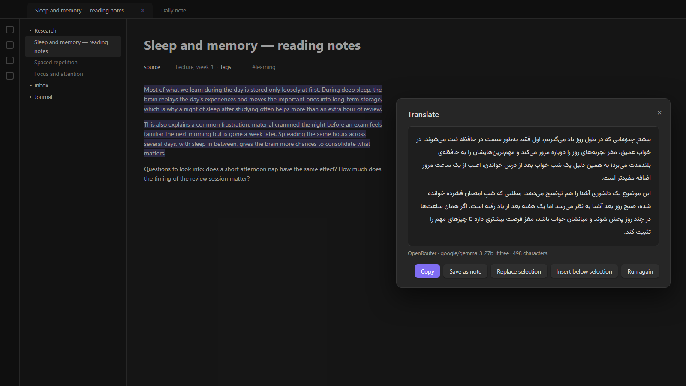
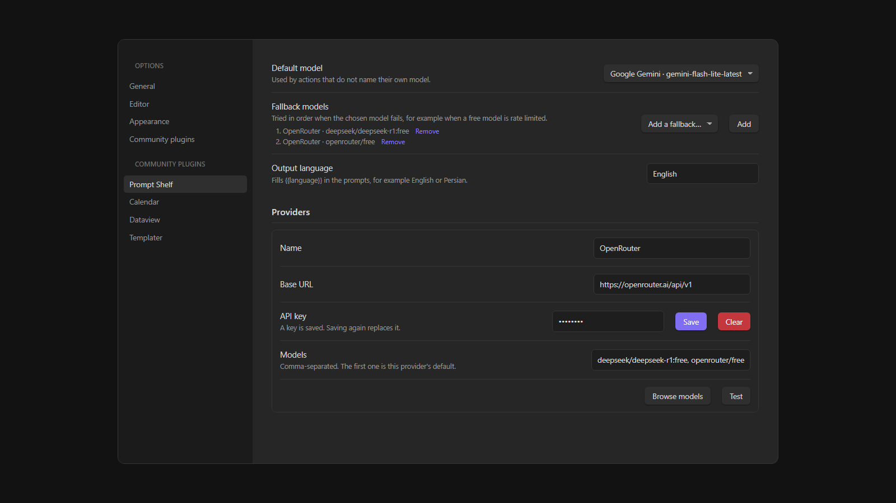
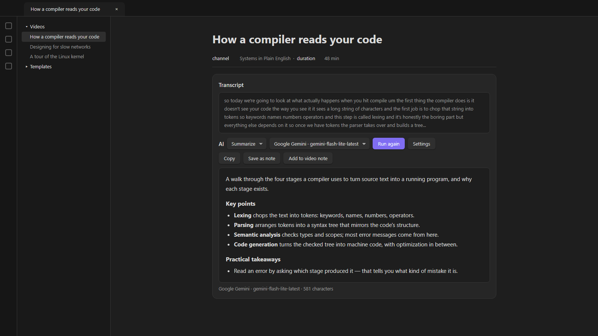
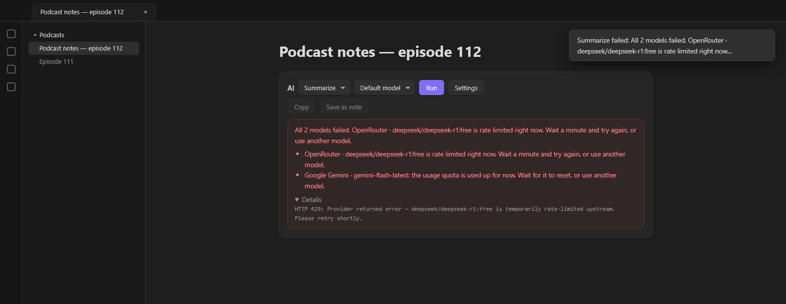

<div dir="rtl">

# Prompt Shelf

*[English](README.md)*

سرویس‌های هوش مصنوعی، کلیدهای API و پرامپت‌های آماده را یک جا نگه دارید و روی هر متنی اجرا کنید؛ از Command Palette یا از کدهای `dataviewjs` و پلاگین‌های خودتان.

هر **کار** (Action) یک پرامپت اسم‌دار است، مثل «خلاصه»، «ترجمه» یا «مرتب کردن زیرنویس». یک بار در تنظیمات می‌نویسیدش و همه‌جا از آن استفاده می‌کنید.



## سرویس‌ها

- **سازگار با OpenAI**: OpenRouter (با مدل‌های رایگانش)، OpenAI، DeepSeek، Groq، Ollama و LM Studio، و هر درگاهی که API چت OpenAI را پشتیبانی کند
- **Anthropic**
- **Google Gemini** (کلید Google AI Studio)

هر سرویس دکمه‌ی **Browse models** دارد که مدل‌های موجود را نشان می‌دهد (مدل‌های رایگان OpenRouter علامت دارند) و دکمه‌ی **Test**.



## استفاده

**راست‌کلیک یا Command Palette**: متنی را انتخاب کنید (یا هیچ، برای کل نوت)، بعد راست‌کلیک کنید و *Run AI action on selection…* را بزنید، یا دستور *Prompt Shelf: Run an action on the selection or the whole note* را از Command Palette اجرا کنید. یک کار را انتخاب کنید؛ جواب در پنجره‌ای باز می‌شود که می‌توانید کپی‌اش کنید، به‌صورت نوت ذخیره کنید، جای متن انتخاب‌شده بگذارید یا زیرش درج کنید.

جواب همان‌طور که نوشته می‌شود نمایش داده می‌شود و دکمه‌ی **Stop** اجرا را وسط کار متوقف می‌کند.

**از کد**: نمونه‌ها در [README انگلیسی](README.md#using-it) هست؛ `app.plugins.plugins["prompt-shelf"].api` با `run`، `chat`، `panel`، `pick` و `saveNote`. مثلاً این نوت زیرنویس یک ویدیو را نشان می‌دهد و با پنل آماده‌ی افزونه خلاصه‌اش می‌کند:



### تصویر، صدا و JSON (نسخه‌ی ۳ ِ API)

از این نسخه `api.version` برابر `3` است و همه‌ی امکانات نسخه‌ی ۲ مثل قبل کار می‌کنند. هر پیام می‌تواند کنار متنش `images` و `audio` داشته باشد (داده به‌صورت base64 بدون پیشوند `data:`)، و `json: true` جواب را به‌صورت JSON و بدون ```` ``` ```` برمی‌گرداند. نمونه‌ی کد در [README انگلیسی](README.md#images-audio-and-json-api-version-3) هست.

- در تنظیمات، هر مدل دو کلید **Images** و **Audio** دارد. درخواستی که تصویر یا صدا دارد فقط به مدل‌هایی می‌رود که این کلیدشان روشن است؛ اگر هیچ‌کدام نباشد، خطای روشن می‌دهد.
- سقف حجم: تصویرها روی هم ۸ مگابایت و صداها ۱۵ مگابایت (به base64). بزرگ‌ترش قبل از ارسال رد می‌شود.
- `api.capabilities()` می‌گوید مدل‌های تنظیم‌شده تصویر، صدا و JSON را قبول می‌کنند یا نه.
- داده‌ی تصویر و صدا هیچ‌جا لاگ، ذخیره یا کش نمی‌شود.

## ذخیره‌ی جواب‌ها

دکمه‌ی **Save as note** جواب را در پوشه‌ای که در تنظیمات تعیین کرده‌اید (پیش‌فرض `Inbox`) ذخیره می‌کند، با اسمی از روی الگو مثل `{{title}} - {{action}}`. کار، مدل، تاریخ و متغیرهایی که کد داده (مثلاً عنوان یا لینک) به‌عنوان property نوت نوشته می‌شوند.

## سطح فکر کردن (Thinking)

هر کار گزینه‌ی **Thinking** دارد: پیش‌فرض مدل، خاموش، کم، متوسط یا زیاد. کمتر یعنی سریع‌تر؛ برای خلاصه معمولاً «کم» کافی است. اگر مدلی این تنظیم را قبول نکند، پیام خطا می‌گوید برش گردانید.

## پرامپت‌ها

- `{{text}}` متن ورودی است. اگر در پرامپت نباشد، متن به انتهای پرامپت اضافه می‌شود.
- `{{language}}` زبان خروجی از تنظیمات است؛ مثلاً Persian.
- کد می‌تواند متغیرهای دیگری مثل `{{title}}` هم بدهد. خطی که همه‌ی متغیرهایش خالی باشد حذف می‌شود.

## متن‌های بلند

متن بلندتر از **Chunk size** تکه‌تکه فرستاده می‌شود. اگر کار **پرامپت ادغام** داشته باشد، جواب تکه‌ها با آن یکی می‌شوند؛ وگرنه پشت هم می‌آیند. برای مدل‌هایی با کانتکست بزرگ مثل Gemini عدد را صفر بگذارید.

## وقتی خطا می‌دهد

پیام خطا روشن می‌گوید چه شده: کلید رد شده، مدل رایگان محدود شده، سهمیه تمام شده، مدل وجود ندارد، متن برای مدل بلند است، سرویس در منطقه‌ی شما در دسترس نیست (مثلاً Gemini بدون VPN)، یا تنظیمات حریم خصوصی OpenRouter جلوی مدل‌های رایگان را گرفته. پیام اصلی سرویس هم زیر *Details* هست.

در تنظیمات **مدل‌های جایگزین** بگذارید تا اگر یکی خطا داد، بعدی امتحان شود.



## شبکه

همه‌ی درخواست‌ها با `requestUrl` ِ خود Obsidian فرستاده می‌شوند، جز جواب‌های تدریجی: `requestUrl` نمی‌تواند پاسخ را تکه‌تکه بخواند، پس برای streaming از `fetch` استفاده می‌شود. اگر سرویسی این را اجازه ندهد، افزونه خودش به `requestUrl` برمی‌گردد و منتظر کل جواب می‌ماند. در تنظیمات می‌شود streaming را خاموش کرد.

## درباره‌ی کلیدها

کلیدها در فایل `secret.json` ِ خود پلاگین ذخیره می‌شوند، **نه** در `data.json`، چون خیلی‌ها `data.json` را در گیت می‌گذارند. این فایل را از گیت و ابزار همگام‌سازی بیرون نگه دارید:

```
.obsidian/plugins/*/secret.json
```

چون این فایل همگام نمی‌شود، کلیدها را روی هر دستگاه یک بار وارد کنید.

## مجوز

MIT — فایل [LICENSE](LICENSE) را ببینید.

</div>
