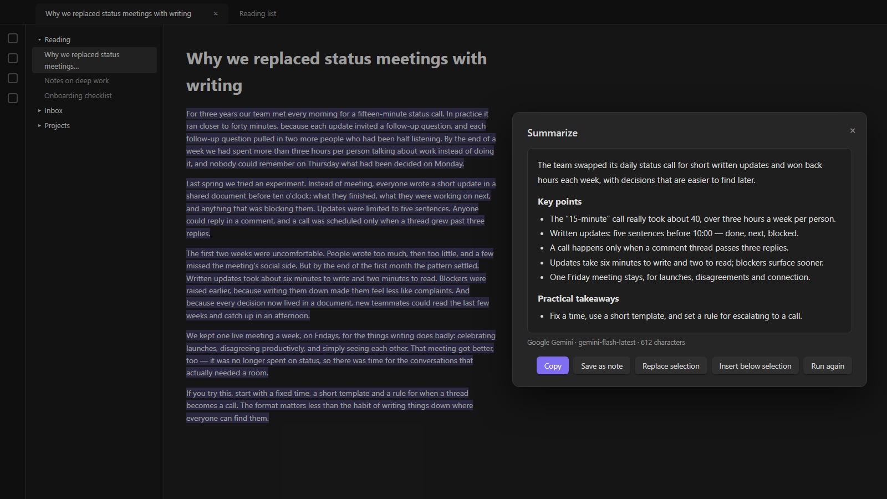
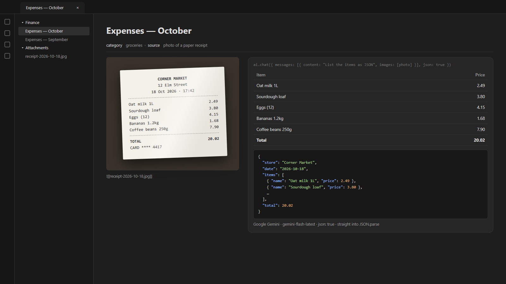
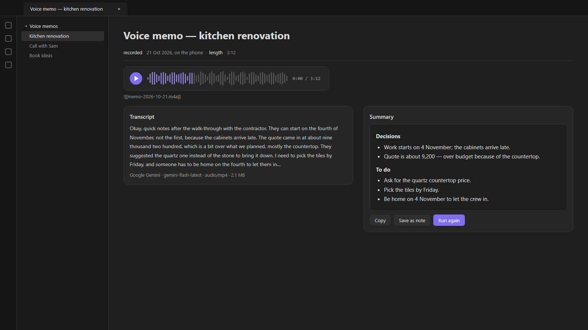
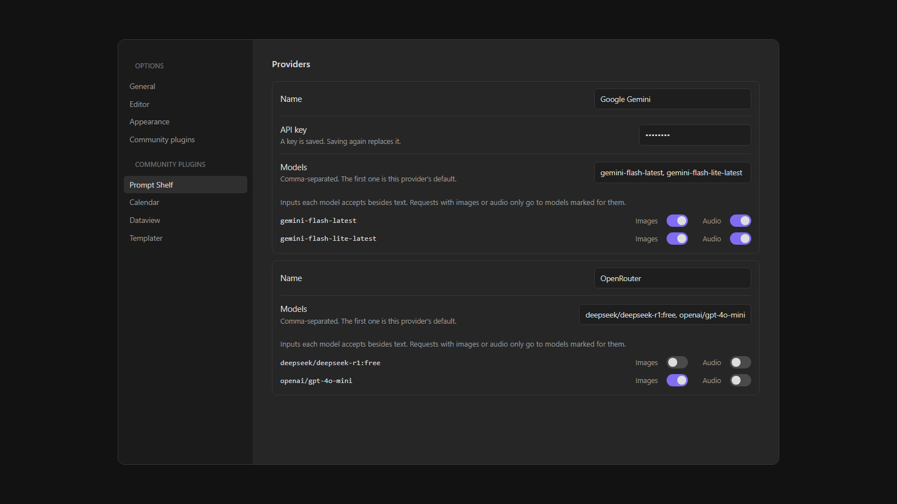

# Prompt Shelf

*[فارسی](README.fa.md)*

Keep your AI providers, API keys and reusable prompts in one place, and run them on any text — from the command palette, or from your own `dataviewjs` and plugin code.

An **action** is a named prompt such as *Summarize*, *Translate* or *Clean up transcript*. Write it once in settings, then use it anywhere.



## Providers

- **OpenAI-compatible**: OpenRouter (including its free models), OpenAI, DeepSeek, Groq, Ollama and LM Studio, and any gateway that speaks the OpenAI chat API
- **Anthropic**
- **Google Gemini** (a Google AI Studio key)

Each provider has a **Browse models** button that lists what the service offers (free OpenRouter models are marked) and a **Test** button.


## Using it

**Right-click or command palette** — select some text (or nothing, for the whole note), then right-click and choose *Run AI action on selection…*, or run *Prompt Shelf: Run an action on the selection or the whole note* from the command palette. Pick an action; the answer streams into a window where you can copy it, save it as a note, replace the selection or insert it below.

Answers appear while they are being written, and a **Stop** button ends a run early. Providers that do not allow streaming from Obsidian fall back to waiting for the whole answer.

**From a script** — the plugin exposes an API. Here a note shows a video's transcript and summarizes it with a ready-made panel:


```js
const ai = app.plugins.plugins["prompt-shelf"]?.api;

// A ready-made panel: action and model pickers, Run, the answer and Copy
const panel = ai.panel(dv.el("div", ""), {
  id: "my-note",                  // remembers the chosen action and model
  getText: () => myText,
  getKey: () => currentItemId,    // answers are cached per key for the session
  vars: () => ({ title: myTitle }),
  defaultAction: "summarize",
  buttons: [{ text: "Add to note", onClick: (answer, action) => { /* … */ } }],
});
panel.result();                   // the answer currently shown, or null
panel.refresh();                  // call after the text changes

// Without UI
const summary = await ai.run("summarize", text, { vars: { title } });
const reply = await ai.chat({ system: "…", prompt: "…" });
```

`ai.saveNote(text, { action, vars })`, `ai.actions()`, `ai.models()`, `ai.ready()`, `ai.pick(text)` and `ai.openSettings()` are also available.

### Images, audio and JSON (API version 3)

`ai.version` is `3`. Everything from version 2 works as before; a request without images or audio sends exactly the same body as it did.

A message can carry images and audio next to its text. `data` is base64 without the `data:` prefix. A photo of a receipt, for example, comes back as items you can put straight into a table:



```js
if (ai.version >= 3 && ai.capabilities().images) {
  const reply = await ai.chat({
    messages: [{
      role: "user",
      content: "List the items on this receipt as JSON: [{ name, price }]",
      images: [{ mime: "image/jpeg", data: base64Jpeg }],   // image/jpeg, image/png or image/webp
    }],
    json: true,
  });
  const items = JSON.parse(reply.text);
}

const transcript = await ai.chat({
  messages: [{ role: "user", content: "Transcribe this.", audio: [{ mime: "audio/mpeg", data: base64Mp3 }] }],
});
```

A voice memo can be transcribed and summarized the same way:



- **Which models get them.** Each model in settings has an **Images** and an **Audio** toggle. A request with images or audio skips every model in the default and fallback chain that is not marked for them, and fails with *No model that accepts images is set up* when none is left. The toggles start on for names containing `gemini`, `gpt-4o`, `gpt-4.1`, `claude` or `vision` (images) and `gemini`, `audio` or `voxtral` (audio). Anthropic has no audio input.
  
- **How they are sent.** Images go as `image_url` parts (OpenAI-compatible), `inline_data` (Gemini) or base64 `image` blocks (Anthropic); audio as `input_audio` parts (OpenAI-compatible) or `inline_data` (Gemini).
- **Size.** Images may add up to 8 MB of base64 per request, audio to 15 MB; larger requests are rejected before anything is sent. Downscale or compress first.
- **JSON.** `json: true` sets `responseMimeType` on Gemini and `response_format: { type: "json_object" }` on OpenAI-compatible providers (retried once without it if the provider answers 400); Anthropic relies on the prompt. The returned text has any ```` ``` ```` fences stripped, so it can go straight into `JSON.parse`.
- **`ai.capabilities()`** returns `{ images, audio, json }`: whether at least one model with a key accepts images, accepts audio, and is set up at all.
- **Privacy.** Image and audio data, and request or response bodies that carry them, are never logged, saved or cached. Error details have long base64 runs replaced with `[data]`.

## Saving answers

**Save as note** creates a note in the folder set in settings (`Inbox` by default), named from a template such as `{{title}} - {{action}}`. The action, model, date and the script's variables — a title or a URL, say — become note properties.

## Thinking

Each action has a **Thinking** level: model default, off, low, medium or high. Lower is faster, and a summary rarely needs more than low. It maps to `reasoning_effort` (OpenAI), `reasoning.effort` (OpenRouter), a thinking budget (Anthropic, Gemini 2.x) or `thinkingLevel` (later Gemini models). A model that does not accept the setting says so, and the error tells you to switch it back.

## Prompts

- `{{text}}` is the input. If a prompt has no `{{text}}`, the text is appended to it.
- `{{language}}` is the output language from settings.
- Scripts can pass any other variable, such as `{{title}}`. A line whose variables are all empty is dropped, so `Title: {{title}}` simply disappears when there is no title.

## Long texts

Texts longer than **Chunk size** are sent in parts. If the action has a **merge prompt**, the parts' answers are combined with it — this is how *Summarize* turns a two-hour transcript into one summary. Otherwise the answers are joined. Set the chunk size to 0 for models with a large context window, such as Gemini.

## When something goes wrong

Errors say what happened in plain words — a rejected key, a rate-limited free model, a used-up quota, a model that does not exist, a text too long for the model, a region the provider does not serve, OpenRouter privacy settings that block free models — with the provider's own message under *Details*.

Add **fallback models** in settings and a failed request moves on to the next one, which is handy with free models that are often rate limited.


## Network

Every request goes through Obsidian's `requestUrl`, except streamed answers: `requestUrl` cannot read a response as it arrives, so streaming uses `fetch`. When a provider does not allow that from Obsidian, the plugin falls back to `requestUrl` and waits for the whole answer. Streaming can be turned off in settings.

Nothing is sent anywhere except to the providers you configure, and only when you run an action.

## About the keys

Keys are stored in the plugin's own `secret.json`, **not** in `data.json`, because many vaults commit `data.json` to git. The settings never show a saved key again; saving replaces it and there is a Clear button. Keys never appear in error messages.

The file is plaintext: a plugin has no OS keychain on mobile. Keep it out of git and other sync tools:

```
.obsidian/plugins/*/secret.json
```

Since the file does not sync, enter your keys once on each device.

## Support

This project is offered for free so everyone can use it without restrictions.
If you found this tool useful, you can support its continuous development and improvement through donations.

<a href="https://www.coffeete.ir/milads55">
  
</a>
<br><br>
<a href="https://buymeabitcoffee.vercel.app/btc/bc1qwxju09p2wywqqq8udj2am8csvn6r4p4z6720q3">
  
</a>

## Licence

MIT — see [LICENSE](LICENSE).
